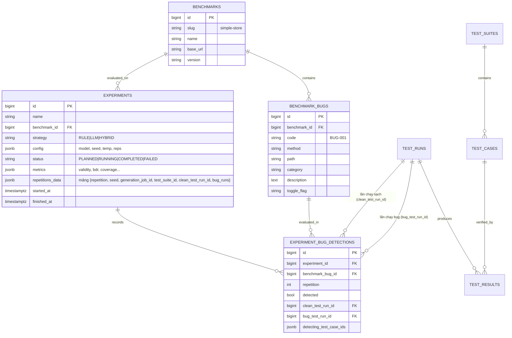

# Thiết kế thực nghiệm đánh giá các chiến lược sinh ca kiểm thử REST API

> **Tài liệu đặc tả kiến trúc thực nghiệm (Task S0-05)**  
> Thuộc đề tài NCKH: *Nghiên cứu và xây dựng nền tảng tự động sinh, thực thi và đánh giá ca kiểm thử API dựa trên mô hình ngôn ngữ lớn*.  
> Mục tiêu: Thiết lập cơ sở lý thuyết, bộ benchmark API chuẩn hóa, danh mục lỗi cài sẵn (seeded bugs), giao thức thực thi và hệ thống chỉ số định lượng phục vụ so sánh 3 chiến lược: **Rule-based (RULE)**, **LLM-based (LLM)** và **Hybrid (HYBRID)**.

---

## 1. Mục tiêu và Câu hỏi nghiên cứu (Research Questions)

Thực nghiệm được thiết kế nhằm đánh giá so sánh một cách khách quan, khoa học và có thể tái lập (reproducible) giữa ba chiến lược sinh ca kiểm thử tự động từ đặc tả OpenAPI 3.x:
1. **Rule-based**: Sinh test dựa trên các quy tắc tất định kết hợp phân tích cú pháp OpenAPI (phân tích giá trị biên, phân vùng tương đương, thiếu trường, sai kiểu dữ liệu).
2. **LLM-based**: Sử dụng mô hình ngôn ngữ lớn cục bộ (`qwen2.5-coder:7b`) với prompt có cấu trúc, sinh test theo định dạng AIT Test DSL v1.0, kết hợp vòng kiểm định (validation) và sửa lỗi tự động (self-repair).
3. **Hybrid**: Kết hợp hạt giống (seed cases) từ Rule-based với khả năng suy luận ngữ cảnh của LLM để mở rộng kiểm thử chuỗi nghiệp vụ (sequence flow), quy tắc logic đặc thù (business rules) và phân quyền (RBAC).

Thực nghiệm giải quyết 4 câu hỏi nghiên cứu cốt lõi:

- **RQ1 (Tính hợp lệ & Khả thi)**: Tỷ lệ ca kiểm thử sinh ra hợp lệ cú pháp/ngữ nghĩa (Validity Rate) và thực thi thành công không gặp lỗi runtime (Executable Rate) giữa các chiến lược khác nhau như thế nào? Tỷ lệ dương tính giả (False Positive Rate) trên phiên bản sạch là bao nhiêu?
- **RQ2 (Hiệu quả phát hiện lỗi)**: Khả năng phát hiện lỗi cài sẵn (Bug Detection Rate) và điểm đột biến (Mutation Score) của từng chiến lược đạt mức nào trên từng nhóm lỗi đặc thù (validation, status code, boundary, business rule, sequence, auth)?
- **RQ3 (Độ bao phủ đặc tả)**: Mức độ bao phủ endpoint (Endpoint Coverage) và các cặp mã trạng thái phản hồi (Status Code Coverage) so với đặc tả OpenAPI của từng chiến lược chênh lệch ra sao?
- **RQ4 (Chi phí và độ dư thừa)**: Mức độ tiêu thụ tài nguyên tính toán (thời gian sinh, thời gian thực thi, tổng số token LLM tiêu thụ) và tỷ lệ sinh trùng lặp (Redundancy Rate) của từng chiến lược là bao nhiêu?

---

## 2. Hệ thống Benchmark APIs

Để đảm bảo tính khách quan và kiểm soát trọn vẹn ground truth, hệ thống sử dụng **3 Benchmark APIs độc lập** do nhóm tự phát triển trên nền tảng **Python FastAPI**, tuân thủ nghiêm ngặt chuẩn OpenAPI 3.x (theo quyết định **D13**).

Mỗi benchmark được đóng gói thành một Docker container độc lập, chạy trong sandbox mạng nội bộ và hỗ trợ bật/tắt từng lỗi cài sẵn thông qua biến môi trường dạng `BUG_<CODE>=1`.

```
benchmark/
├── simple-store/                 # Benchmark #1: CRUD & Validation cơ bản
│   ├── app/                      # Mã nguồn FastAPI
│   ├── openapi.yaml              # Đặc tả chuẩn OpenAPI 3.x
│   ├── ground-truth.yaml         # Danh mục 10 bug, toggle flags, phân loại
│   └── tests/                    # Pytest kiểm chứng sai khác hành vi
├── ecommerce-order/              # Benchmark #2: Chuỗi nghiệp vụ & Phân quyền
│   ├── app/
│   ├── openapi.yaml
│   ├── ground-truth.yaml         # Danh mục 12 bug
│   └── tests/
└── appointment-booking/          # Benchmark #3: Ràng buộc nghiệp vụ phức tạp & Thời gian
    ├── app/
    ├── openapi.yaml
    ├── ground-truth.yaml         # Danh mục 10 bug
    └── tests/
```

### Chi tiết 3 Benchmark:

| Benchmark | Slug | Miền nghiệp vụ | Đặc trưng kỹ thuật | Số Endpoint (không tính `/health`) | Số Bug | Sprint |
|---|---|---|---|---|---|---|
| **#1 Simple Store** | `simple-store` | Quản lý sản phẩm, danh mục, kho hàng | CRUD tài nguyên độc lập; validation kiểu dữ liệu nguyên thủy (string, int, float, enum, regex); phân trang | 8 | 10 | S1-06, S2-04 |
| **#2 E-commerce Order** | `ecommerce-order` | Giỏ hàng, Đơn hàng, Thanh toán, Quản lý kho | Chuỗi phụ thuộc nhiều bước (Cart $\to$ Item $\to$ Checkout $\to$ Order $\to$ Payment); Phân quyền RBAC (Customer vs Admin); Chuyển trạng thái đơn hàng | 12 | 12 | S5-04, S7-04 |
| **#3 Appointment Booking** | `appointment-booking` | Đặt lịch khám bệnh, Quản lý bác sĩ, Phòng ban | Ràng buộc nghiệp vụ logic cao (không trùng giờ, hủy trước 24h, quota bệnh nhân/ngày, ngày làm việc); Xử lý múi giờ và thời gian thực | 9 | 10 | S8-03 |
| **Tổng cộng** | — | — | — | **29** | **32** | — |

> Số endpoint là số operation (method + path) trong `openapi.yaml` của từng benchmark, không tính `GET /health`. Mẫu số của Endpoint Coverage (§11) do `SpecCoverageAnalyzer` tính trên **mọi** operation đã parse từ spec, tức là gồm cả `GET /health`: 9 / 13 / 10 (tổng 32).

---

## 3. Phân loại lỗi cài sẵn (Bug Taxonomy & Ground Truth)

Tổng cộng **32 seeded bugs** được cài đặt phân bổ đều vào 7 danh mục lỗi API phổ biến (đáp ứng tiêu chí $\ge 30$ bug của đề tài):

1. `VALIDATION_MISSING`: Server chấp nhận dữ liệu đầu vào không hợp lệ (bỏ sót validate định dạng email, khoảng giá trị, thiếu trường bắt buộc).
2. `STATUS_CODE_WRONG`: Server trả sai mã trạng thái HTTP so với hợp đồng OpenAPI (ví dụ: tạo thành công trả 200 thay vì 201; không tìm thấy trả 200 kèm body rỗng thay vì 404).
3. `SCHEMA_MISMATCH`: Dữ liệu response JSON trả về thiếu trường bắt buộc hoặc sai kiểu dữ liệu đã cam kết trong schema OpenAPI.
4. `BOUNDARY_ERROR`: Lỗi xử lý cận trên/cận dưới (lỗi off-by-one: cho phép nhập giá trị vượt ngưỡng tối đa hoặc âm).
5. `BUSINESS_RULE_VIOLATION`: Vi phạm các ràng buộc logic nghiệp vụ (cho phép áp voucher khi chưa đủ điều kiện tối thiểu; cho phép đặt lịch trùng ca).
6. `SEQUENCE_ERROR`: Lỗi phụ thuộc thứ tự (cho phép thanh toán đơn hàng chưa được tạo, cho phép hủy đơn khi đã hoàn tất giao hàng).
7. `AUTH_ERROR`: Lỗi xác thực và phân quyền (cho phép người dùng thường truy cập endpoint quản trị viên hoặc xem đơn hàng của người khác - IDOR).

### Bảng danh mục Ground Truth chi tiết:

| Mã Bug | Benchmark | Method & Path | Phân loại | Mô tả lỗi cài sẵn | Toggle Flag | Chiến lược kỳ vọng |
|---|---|---|---|---|---|---|
| `BUG-001` | simple-store | `POST /products` | `VALIDATION_MISSING` | Cho phép tạo sản phẩm không có trường `name` | `BUG_001` | RULE, LLM, HYBRID |
| `BUG-002` | simple-store | `POST /products` | `BOUNDARY_ERROR` | Cho phép giá sản phẩm âm (`price < 0`) | `BUG_002` | RULE, LLM, HYBRID |
| `BUG-003` | simple-store | `POST /products` | `STATUS_CODE_WRONG` | Tạo sản phẩm thành công nhưng trả HTTP `200` thay vì `201` | `BUG_003` | RULE, LLM, HYBRID |
| `BUG-004` | simple-store | `GET /products/{id}` | `STATUS_CODE_WRONG` | ID không tồn tại trả `200` với `{}` thay vì `404 Not Found` | `BUG_004` | RULE, LLM, HYBRID |
| `BUG-005` | simple-store | `GET /products/{id}` | `SCHEMA_MISMATCH` | Response thiếu trường bắt buộc `sku` đã mô tả trong OpenAPI | `BUG_005` | RULE, LLM, HYBRID |
| `BUG-006` | simple-store | `PUT /products/{id}` | `BOUNDARY_ERROR` | Cho phép cập nhật số lượng tồn kho `quantity` vượt quá max (100,000) | `BUG_006` | RULE, LLM, HYBRID |
| `BUG-007` | simple-store | `GET /products` | `VALIDATION_MISSING` | Không kiểm tra `limit <= 0` hoặc `limit > 100`, dẫn đến sập server (500) | `BUG_007` | RULE, LLM, HYBRID |
| `BUG-008` | simple-store | `POST /categories` | `BUSINESS_RULE_VIOLATION`| Cho phép tạo 2 danh mục trùng mã `slug` (vi phạm tính unique) | `BUG_008` | LLM, HYBRID |
| `BUG-009` | simple-store | `DELETE /products/{id}` | `STATUS_CODE_WRONG` | Xóa thành công trả `200` kèm body thay vì `204 No Content` | `BUG_009` | RULE, LLM, HYBRID |
| `BUG-010` | simple-store | `GET /products/{id}` | `VALIDATION_MISSING` | Truyền `id` dạng string chữ cái gây unhandled exception `500` thay vì `400/422` | `BUG_010` | RULE, LLM, HYBRID |
| `BUG-011` | ecommerce-order | `POST /cart/items` | `BOUNDARY_ERROR` | Cho phép thêm sản phẩm vào giỏ với số lượng `quantity = 0` | `BUG_011` | RULE, LLM, HYBRID |
| `BUG-012` | ecommerce-order | `POST /cart/items` | `BUSINESS_RULE_VIOLATION`| Cho phép thêm số lượng vượt quá tồn kho thực tế của sản phẩm | `BUG_012` | HYBRID, LLM |
| `BUG-013` | ecommerce-order | `POST /checkout` | `SEQUENCE_ERROR` | Cho phép checkout một giỏ hàng rỗng (`cart_id` chưa có item nào) | `BUG_013` | HYBRID, LLM |
| `BUG-014` | ecommerce-order | `POST /checkout` | `STATUS_CODE_WRONG` | Checkout thành công nhưng không trả header `Location` hoặc sai mã HTTP | `BUG_014` | RULE, LLM, HYBRID |
| `BUG-015` | ecommerce-order | `POST /orders/{id}/pay` | `SEQUENCE_ERROR` | Cho phép gọi thanh toán 2 lần cho cùng một đơn hàng (`Double payment`) | `BUG_015` | HYBRID |
| `BUG-016` | ecommerce-order | `POST /orders/{id}/cancel` | `BUSINESS_RULE_VIOLATION`| Cho phép hủy đơn hàng khi trạng thái đã là `SHIPPED` | `BUG_016` | HYBRID, LLM |
| `BUG-017` | ecommerce-order | `GET /admin/orders` | `AUTH_ERROR` | Người dùng thường (role `CUSTOMER`) gọi được endpoint của `ADMIN` | `BUG_017` | HYBRID, LLM |
| `BUG-018` | ecommerce-order | `GET /orders/{id}` | `AUTH_ERROR` | Khách hàng A xem được thông tin đơn hàng của khách hàng B (IDOR) | `BUG_018` | HYBRID |
| `BUG-019` | ecommerce-order | `POST /orders` | `SCHEMA_MISMATCH` | Response tạo đơn hàng trả về `total_amount` dạng string thay vì number | `BUG_019` | RULE, LLM, HYBRID |
| `BUG-020` | ecommerce-order | `POST /coupons/apply` | `BUSINESS_RULE_VIOLATION`| Áp dụng mã giảm giá khi tổng tiền đơn hàng chưa đạt mức tối thiểu | `BUG_020` | HYBRID, LLM |
| `BUG-021` | ecommerce-order | `DELETE /cart/items/{id}`| `STATUS_CODE_WRONG` | Xóa item không có trong cart trả `500` thay vì `404` | `BUG_021` | RULE, LLM, HYBRID |
| `BUG-022` | ecommerce-order | `GET /cart` | `SCHEMA_MISMATCH` | Response thiếu mảng `items` khi giỏ hàng trống (trả `null` thay vì `[]`) | `BUG_022` | RULE, LLM, HYBRID |
| `BUG-023` | appointment-booking | `POST /appointments` | `BOUNDARY_ERROR` | Cho phép đặt lịch vào ngày trong quá khứ (`appointment_date < today`) | `BUG_023` | RULE, LLM, HYBRID |
| `BUG-024` | appointment-booking | `POST /appointments` | `BUSINESS_RULE_VIOLATION`| Cho phép 2 lịch hẹn trùng bác sĩ và trùng khung giờ (Double booking) | `BUG_024` | HYBRID, LLM |
| `BUG-025` | appointment-booking | `POST /appointments` | `BUSINESS_RULE_VIOLATION`| Đặt lịch vào ngày nghỉ/ngày lễ của phòng khám | `BUG_025` | HYBRID, LLM |
| `BUG-026` | appointment-booking | `POST /appointments` | `STATUS_CODE_WRONG` | Trùng lịch trả HTTP `500` thay vì `409 Conflict` | `BUG_026` | RULE, LLM, HYBRID |
| `BUG-027` | appointment-booking | `PATCH /appointments/{id}`| `BUSINESS_RULE_VIOLATION`| Cho phép dời lịch khi thời gian còn lại trước giờ hẹn $< 24$ giờ | `BUG_027` | HYBRID, LLM |
| `BUG-028` | appointment-booking | `POST /appointments` | `BUSINESS_RULE_VIOLATION`| Cho phép số lượng lịch hẹn của 1 bác sĩ trong ngày vượt quota (tối đa 20) | `BUG_028` | HYBRID |
| `BUG-029` | appointment-booking | `GET /doctors/{id}/slots` | `SCHEMA_MISMATCH` | Slot thời gian trả về sai định dạng ISO 8601 (`YYYY-MM-DDTHH:mm:ssZ`) | `BUG_029` | RULE, LLM, HYBRID |
| `BUG-030` | appointment-booking | `DELETE /appointments/{id}`| `AUTH_ERROR` | Bệnh nhân này hủy lịch hẹn của bệnh nhân khác không cần token bác sĩ | `BUG_030` | HYBRID |
| `BUG-031` | appointment-booking | `GET /departments/{id}` | `STATUS_CODE_WRONG` | ID phòng ban không hợp lệ trả `400` nhưng content-type là `text/html` | `BUG_031` | RULE, LLM, HYBRID |
| `BUG-032` | appointment-booking | `POST /appointments` | `VALIDATION_MISSING` | Không kiểm tra định dạng số điện thoại liên hệ của bệnh nhân | `BUG_032` | RULE, LLM, HYBRID |

---

## 4. Giao thức chạy thực nghiệm (Experimental Protocol)

### 4.1 Định nghĩa Phát hiện Lỗi (Quyết định D14)

Để đảm bảo kết quả thực nghiệm hoàn toàn không bị sai lệch bởi lỗi nội tại của bộ test (test hallucination hoặc test case tự sinh sai), hệ thống áp dụng nguyên tắc kiểm định chéo giữa **Biến thể sạch (Clean Variant)** và **Biến thể lỗi (Bug Variant)**:

> **Nguyên tắc D14**:  
> Một lỗi $B_i$ được tính là **phát hiện thành công** bởi ca kiểm thử $t$ khi và chỉ khi:
> 1. Ca kiểm thử $t$ có kết quả **`PASS`** trên bản sạch (Clean Variant - không bật bug).
> 2. Ca kiểm thử $t$ có kết quả **`FAIL`** hoặc **`ERROR`** trên bản có bug (Bug Variant - khi bật toggle `BUG_Bi=1`).

$$\text{Detected}(B_i, t) = \Big(\text{Verdict}(t, \text{Clean}) = \text{PASS}\Big) \;\wedge\; \Big(\text{Verdict}(t, \text{Bug}_{B_i}) \in \{\text{FAIL}, \text{ERROR}\}\Big)$$

- **Xử lý Dương tính giả (False Positive)**: Nếu một ca kiểm thử $t$ cho kết quả `FAIL` ngay trên bản sạch (Clean Variant), ca kiểm thử đó vi phạm tính đúng đắn của Test Oracle, bị gắn cờ **False Positive** và **bị loại bỏ hoàn toàn** khỏi tập test dùng để tính điểm phát hiện bug.

### 4.2 Thiết lập Cấu hình Thực nghiệm

Thực nghiệm là một phép đo tích chéo gồm các nhân tố:

$$\mathcal{E} = \{\text{Chiến lược}\} \times \{\text{Benchmark}\} \times \{\text{Model LLM}\} \times \{\text{Lần lặp}\}$$

- **Chiến lược sinh test**:
  - `RULE`: Rule-based generator (PHP).
  - `LLM`: LLM generator với structured prompt và self-repair (FastAPI ai-service).
  - `HYBRID`: Rule-based seed + LLM sequence/rule generation.
- **Mô hình LLM**: `qwen2.5-coder:7b` (chạy local qua Ollama, OpenAI-compatible endpoint).
- **Tham số sinh test (cố định để kiểm soát)**:
  - `temperature = 0.2` (đảm bảo tính ổn định và bám sát cấu trúc DSL).
  - `max_repair_attempts = 2` (số lần tối đa gửi phản hồi lỗi cho LLM sửa).
  - ~~`timeout = 120s` cho mỗi request gọi LLM~~: thay bằng giao thức LLM local của **ADR-0005** (`docs/adr/0005-local-llm-experiment-budgets.md`, trạng thái Chấp nhận): mỗi endpoint một lời gọi GENERATE yêu cầu `AI_LLM_CASES_PER_CALL = 3` case (`max_tokens` = 3 × 400 + 256), timeout 300 s mỗi lời gọi, ngân sách 1320 s mỗi lần sinh (web chờ 1380 s, job 1500 s), context Ollama ≥ 16384 token. Trần case mỗi endpoint: RULE ≤ 10; LLM yêu cầu 3, giữ tối đa 10; HYBRID = seed RULE + phần LLM. Giá trị thực tế mỗi lần chạy ghi trong `environment.txt` của `make experiment`.
- **Số lần lặp (Repetitions)**: **$N = 3$ lần lặp độc lập** cho mỗi cấu hình thực nghiệm.
  - Các seed cố định: `Seed 1 = 42`, `Seed 2 = 1024`, `Seed 3 = 2026` (cấu hình bằng `EXPERIMENT_SEEDS`, lưu vào `experiments.config.seeds`; lần lặp r dùng `seeds[r-1]`, lặp nhiều hơn số seed thì nối tiếp `seed cuối + 1`, … — ADR-0003).
  - Mọi thông số (Prompt, Raw Response, Latency, Token Usage) đều được lưu nguyên văn vào bảng `llm_call_logs`.
- **Credential và business rules**: theo **ADR-0006** (§7.1) — fixture xác thực synthetic và business rules của `ground-truth.yaml` được snapshot vào `experiments.config`; executor gửi credential mặc định như nhau cho mọi chiến lược; bản xuất có `config.auth`, `config.business_rules` và `generation_job_ids` của từng lần lặp.

### 4.3 Quy trình thực thi và Giao thức Cô lập Sandbox (Execution Workflow & Sandbox Isolation)

Để đảm bảo tính tái lập và triệt tiêu sai lệch do trạng thái dữ liệu (đặc biệt với các test case CRUD hoặc SEQUENCE làm thay đổi DB target), giao thức thực nghiệm bắt buộc tuân thủ 4 nguyên tắc cô lập:

#### 4.3.1 Nguyên tắc Cô lập và Reset Dữ liệu Sandbox
1. **Dữ liệu Seed Chuẩn hóa (Baseline Seed Data)**: Mỗi benchmark API sở hữu một bộ fixture/seed data xác định được nạp sẵn vào sandbox trước mọi hoạt động kiểm thử.
2. **Cơ chế Reset Trạng thái Sandbox (Sandbox State Reset)**: Sandbox benchmark cung cấp cơ chế reset dữ liệu nội bộ (qua endpoint quản trị `POST /__admin/reset` hoặc script khởi tạo lại sandbox DB). Lệnh reset đưa toàn bộ dữ liệu trong sandbox về đúng trạng thái seed ban đầu.
3. **Thời điểm Kích hoạt Reset và Bảo toàn Điều kiện Chạy**:
   - **Trước mỗi Lần lặp ($r \in \{1..N\}$)**: Đảm bảo lần lặp mới hoàn toàn độc lập, không bị ảnh hưởng bởi dữ liệu thừa từ lần lặp trước.
   - **Trước lượt chạy Bản sạch (Baseline Clean Run)**: Đảm bảo bản sạch chạy trên dữ liệu seed tinh khiết.
   - **Trước mỗi lượt chạy Biến thể Bug (Bug Mutation Evaluation Run)**: Đảm bảo mỗi biến thể bug chạy trên cùng một trạng thái dữ liệu ban đầu giống hệt bản sạch.
   - **Trước mỗi Test case (ADR-0006, bổ sung 2026-10-12)**: với `EXPERIMENT_RESET_PER_CASE=true` (mặc định, lưu ở `experiments.config.reset_per_case`), mỗi test case của lượt chạy thực nghiệm (bản sạch và mọi biến thể bug, mọi chiến lược như nhau) bắt đầu từ dữ liệu seed: reset cấp lượt chạy phục vụ case đầu, sau đó `POST <variant>/__admin/reset` trước mỗi case tiếp theo. Một case SEQUENCE nhiều bước vẫn chạy liên tục trong một trạng thái. Nhờ vậy kết quả của một case không phụ thuộc case khác (giỏ hàng bị case trước làm rỗng, slot đã bị case trước đặt) và không có "phát hiện" nhờ rò rỉ trạng thái giữa các case. Reset lỗi làm lượt chạy và thực nghiệm FAILED. Lượt chạy M12 thông thường (ngoài thực nghiệm) tới host benchmark trong `RUN_RESET_BENCHMARK_HOSTS` cũng reset trước từng case, kể cả case đầu, nhưng reset lỗi chỉ làm case đó `ERROR` (ADR-0006, bổ sung 2026-10-13).
   - **Bảo toàn Trật tự và Môi trường Dữ liệu**: Cả lượt chạy bản sạch và từng lượt chạy biến thể bug đều phải thực thi **toàn bộ TestSuite** theo đúng một thứ tự. Không lọc bỏ các case không đạt trên bản sạch trước khi chạy trên biến thể bug. Toàn bộ suite được chạy trên cả hai biến thể, và quy tắc D14 chỉ đối chiếu kết quả của những case vốn PASS trên bản sạch để kết luận phát hiện lỗi. Thực nghiệm tạo trước bổ sung ADR-0006 ngày 2026-10-12 (không có `config.reset_per_case`) chạy các case nối tiếp trên cùng trạng thái; số liệu hai chế độ không so sánh trực tiếp được.
4. **Cô lập Đơn lỗi (Single-Fault Isolation Protocol)**:
   - Tại mỗi thời điểm đánh giá mutant bug $B_i$, **CHỈ DUY NHẤT** toggle của bug đó được kích hoạt (`TOGGLE_BUG_Bi=1`), toàn bộ các biến toggle khác trong benchmark bị tắt triệt để (`=0`).
   - Sau khi hoàn tất lượt chạy cho bug $B_i$, tắt toggle của $B_i$, gọi lệnh Reset sandbox về dữ liệu seed ban đầu trước khi kích hoạt bug tiếp theo $B_{i+1}$. Điều này loại trừ hoàn toàn hiện tượng tương tác lỗi chồng chéo (fault interaction).
   - **Hiện thực (S12-02)**: thay vì bật/tắt toggle trên cùng một tiến trình, mỗi bug chạy trong một container riêng chỉ có `BUG_xxx=1` (`docker/docker-compose.experiment.yml`, sinh từ `ground-truth.yaml`). Hostname bản sạch là `<slug>`, biến thể bug là `<slug>-<code viết thường>` (ví dụ `simple-store-bug-001`), tương ứng `BENCHMARK_VARIANT_URL_TEMPLATE=http://{slug}-{code_lower}:8000`. Reset dùng `POST /__admin/reset` (không công bố trong `openapi.yaml`). Chi tiết: `benchmark/README.md`.

#### 4.3.2 Sơ đồ Quy trình Thực thi Chi tiết

```
       ┌────────────────────────────────────────────────────────────────────────┐
       │ Bước 0: Khởi tạo Lần lặp r (Repetition Setup r ∈ {1..N})               │
       │ - Cố định Seed LLM (42, 1024, 2026...)                                 │
       │ - Reset Sandbox về Baseline Seed Data                                  │
       └───────────────────────────────────┬────────────────────────────────────┘
                                           │
                                           ▼
       ┌────────────────────────────────────────────────────────────────────────┐
       │ Bước 1: Sinh bộ kiểm thử (Generation Phase)                            │
       │ - Khởi tạo GenerationJob(strategy, params, seed_r) ➔ tạo TestSuite_r   │
       │ - Validate JSON Schema DSL v1.0 & Kiểm tra ngữ nghĩa                   │
       │ - Deduplication qua Fingerprint (SHA-256)                              │
       │ ➔ Thu được Test Suite gồm các case VALID                               │
       └───────────────────────────────────┬────────────────────────────────────┘
                                           │
                                           ▼
       ┌────────────────────────────────────────────────────────────────────────┐
       │ Bước 2: Thực thi trên Bản sạch (Baseline Clean Run)                    │
       │ - Reset Sandbox về Baseline Seed Data                                  │
       │ - Tắt toàn bộ bug toggles (Môi trường hoàn toàn sạch)                  │
       │ - Khởi tạo TestRun sạch (CleanRun_r), thực thi toàn bộ TestSuite_r     │
       │ - Tính Executable Rate & False Positive Rate                           │
       │ - Xác định tập PassClean = {case c | Result_clean(c) == PASS}          │
       └───────────────────────────────────┬────────────────────────────────────┘
                                           │
                                           ▼
       ┌────────────────────────────────────────────────────────────────────────┐
       │ Bước 3: Đánh giá Đột biến từng Bug (Bug Mutation Evaluation)           │
       │ Với mỗi Bug Bi trong Ground Truth:                                     │
       │   1. Reset Sandbox về Baseline Seed Data                               │
       │   2. Bật DUY NHẤT toggle biến môi trường BUG_Bi=1 (các bug khác = 0)   │
       │   3. Khởi tạo BugTestRun_r_Bi, thực thi TOÀN BỘ TestSuite_r theo đúng  │
       │      thứ tự như bản sạch (bảo toàn trật tự side-effect dữ liệu)        │
       │   4. Đối chiếu D14: Bug Bi được phát hiện (detected=true) khi tồn tại  │
       │      ít nhất 1 case c ∈ PassClean có Result_bug(c) ∈ {FAIL, ERROR}    │
       │      (Các case vốn đã FAIL/ERROR trên bản sạch không được tính phát    │
       │       hiện để loại bỏ hoàn toàn False Positive do lỗi sinh test)       │
       │   5. Ghi nhận kết quả vào experiment_bug_detections kèm FK test runs   │
       │   6. Tắt toggle BUG_Bi                                                 │
       └───────────────────────────────────┬────────────────────────────────────┘
                                           │
                                           ▼
       ┌────────────────────────────────────────────────────────────────────────┐
       │ Bước 4: Tổng hợp Chỉ số & Báo cáo (Reporting Phase)                    │
       │ - Cập nhật repetitions_data trong experiments                          │
       │ - Tính toán toàn bộ 9 chỉ số định lượng theo §5                        │
       │ - Tính trung bình và độ lệch chuẩn qua N lần lặp                       │
       │ - Cập nhật metrics trong experiments và xuất báo cáo                   │
       └────────────────────────────────────────────────────────────────────────┘
```

---

## 5. Hệ thống Chỉ số Đánh giá Định lượng (Evaluation Metrics)

Hệ thống đánh giá định lượng gồm 9 chỉ số phân thành 4 nhóm năng lực:

### Nhóm 1: Tính Hợp lệ và Khả thi (Validity & Feasibility)

1. **Tỷ lệ Hợp lệ (Validity Rate - $VR$)**: Tỷ lệ ca kiểm thử sinh ra vượt qua khâu kiểm tra JSON Schema DSL và tính đúng đắn ngữ nghĩa so với spec OpenAPI.
   $$VR = \frac{N_{\text{valid}}}{N_{\text{generated}}} \times 100\%$$
   *(Trong đó $N_{\text{generated}}$ là tổng số test case sinh ra; $N_{\text{valid}}$ là số case có trạng thái `VALID`).*

2. **Tỷ lệ Khả thi (Executable Rate - $ER$)**: Tỷ lệ ca kiểm thử hợp lệ có thể gửi request thành công tới server mà không gặp lỗi kết nối, DNS hoặc timeout (`ERROR`).
   $$ER = \frac{N_{\text{executed}}}{N_{\text{valid}}} \times 100\%$$
   *(Trong đó $N_{\text{executed}}$ là số test case có verdict là `PASS` hoặc `FAIL` trên bản sạch).*

3. **Tỷ lệ Dương tính giả (False Positive Rate - $FPR$)**: Tỷ lệ ca kiểm thử bị fail vô lý trên hệ thống sạch chuẩn (do test oracle sinh sai hoặc dữ liệu mock không hợp lệ).
   $$FPR = \frac{N_{\text{fail on clean}}}{N_{\text{executed}}} \times 100\%$$

### Nhóm 2: Năng lực Phát hiện Lỗi (Fault Detection Effectiveness)

4. **Tỷ lệ Phát hiện Lỗi (Bug Detection Rate - $BDR$)**: Tỷ lệ lỗi cài sẵn trong benchmark được phát hiện theo nguyên tắc D14.
   $$BDR = \frac{N_{\text{detected bugs}}}{N_{\text{total seeded bugs}}} \times 100\%$$

5. **Điểm Đột biến (Mutation Score - $MS$)**: Tỷ lệ các biến thể đột biến (mutants) bị tiêu diệt bởi bộ test.
   $$MS = \frac{\sum_{i=1}^{M} \mathbb{I}(\text{Mutant}_i \text{ is Killed})}{M} \times 100\%$$
   *(Mỗi bug $B_i$ tương ứng 1 mutant; $M$ là tổng số mutant đang được kiểm thử).*

### Nhóm 3: Mức độ Bao phủ Đặc tả (Specification Coverage)

6. **Độ bao phủ Endpoint (Endpoint Coverage - $EC$)**: Tỷ lệ endpoint trong spec có ít nhất 1 ca kiểm thử hợp lệ được sinh ra.
   $$EC = \frac{|\{e \in \text{Endpoints} \mid \exists t \in \text{Suite}_{\text{valid}}: t.\text{endpoint} = e\}|}{|\text{Endpoints}|} \times 100\%$$

7. **Độ bao phủ Mã phản hồi (Status Code Coverage - $SCC$)**: Tỷ lệ các cặp `(endpoint, status_code)` được định nghĩa trong OpenAPI có xuất hiện trong assertion của bộ test.
   $$SCC = \frac{|\text{Cặp } (e, s) \text{ được assert trong Suite}|}{|\text{Tổng cặp } (e, s) \text{ khai báo trong OpenAPI}|} \times 100\%$$

### Nhóm 4: Chi phí và Hiệu năng (Efficiency & Overhead)

8. **Tỷ lệ Trùng lặp (Redundancy Rate - $RR$)**: Tỷ lệ ca kiểm thử sinh ra bị trùng lặp nội dung thực thi (sau khi chuẩn hóa DSL và băm fingerprint SHA-256).
   $$RR = \frac{N_{\text{duplicate}}}{N_{\text{generated}}} \times 100\%$$

9. **Chi phí Thời gian và Tài nguyên**:
   - **Thời gian sinh trung bình ($T_{\text{gen}}$)**: Giây.
   - **Thời gian thực thi trung bình ($T_{\text{exec}}$)**: Giây.
   - **Số Token LLM tiêu thụ**: Tổng Prompt Tokens và Completion Tokens tiêu tốn cho mỗi endpoint.

---

## 6. Mô hình Lưu trữ Dữ liệu Thực nghiệm (Schema mapping)

Dữ liệu thực nghiệm được lưu trữ trực tiếp vào cơ sở dữ liệu PostgreSQL của hệ thống (theo `docs/contracts/db-schema.md`). Mọi lần lặp đều có thể truy ngược toàn vẹn tới Generation Job, Test Suite, Clean Run và từng Bug Run:



---

## 7. Cấu trúc chuẩn file `ground-truth.yaml`

Mỗi benchmark lưu trữ danh sách bug trong file `benchmark/<slug>/ground-truth.yaml` theo định dạng chuẩn hóa sau:

```yaml
version: "1.0"
benchmark: "simple-store"
base_url: "http://simple-store:8000"  # alias Docker của bản sạch (S12-02)
bugs:
  - code: "BUG-001"
    method: "POST"
    path: "/products"
    category: "VALIDATION_MISSING"
    toggle_env: "BUG_001"
    description: "Accepts creation of product without name field"
    expected_clean_status: 422
    actual_bug_status: 201
    oracle_assertion:
      type: "status"
      equals: 422

  - code: "BUG-002"
    method: "POST"
    path: "/products"
    category: "BOUNDARY_ERROR"
    toggle_env: "BUG_002"
    description: "Allows negative price product creation"
    expected_clean_status: 422
    actual_bug_status: 201
    oracle_assertion:
      type: "status"
      equals: 422
```

### 7.1 Fixture thực nghiệm: xác thực và business rules (ADR-0006)

Hai khóa tùy chọn của `ground-truth.yaml`, được **snapshot vào `experiments.config`** khi tạo thực nghiệm (mọi lần lặp và bản xuất dùng đúng snapshot này, không đọc lại tệp hay business rules của project):

```yaml
auth:                         # benchmark có endpoint yêu cầu bearer token
  scheme: "bearer"
  default_role: "customer"
  roles:
    customer: { token: "customer-alice-token", description: "CUSTOMER alice" }
    admin:    { token: "admin-token", description: "ADMIN" }
  operations:                 # vai trò riêng theo operation, lấy từ tài liệu spec
    - { method: "GET", path: "/admin/orders", role: "admin", forbidden_roles: ["customer"] }
business_rules:               # hành vi đúng mà người kiểm thử đọc được từ spec/README, không phải đáp án bug
  - { code: "BR-EO-011", method: "GET", path: "/admin/orders", description: "..." }
```

Quy tắc dùng credential, giống nhau cho RULE, LLM và HYBRID (chi tiết và lý do: `docs/adr/0006-experiment-auth-fixture-business-rules.md`):

- Lượt chạy định nghĩa biến `auth_token_<role>` cho mọi vai trò (ưu tiên hơn `variables` của case).
- Step gọi operation có security, request chưa có header `Authorization` và case không phải `AUTH` → executor thêm `Authorization: Bearer {{auth_token_<role>}}` (vai trò của operation, nếu không thì `default_role`).
- Case `AUTH` tự đặt hoặc bỏ header (thiếu/sai token → 401, vai trò bị cấm → 403).
- RULE: endpoint có security được sinh đủ 6 kỹ thuật cùng các case `AUTH` (thiếu token, token sai, từng `forbidden_roles`); LLM/HYBRID: prompt có tên vai trò và placeholder, **không có token**; business rules lấy từ snapshot.
- `simple-store` không có `auth` (không có endpoint bảo mật), chỉ có `business_rules`.
- Công bằng giữa các chiến lược (S11-01): mỗi operation nghiệp vụ (trừ `/health`) có 1–2 business rule, kể cả operation không có seeded bug; rule chỉ nhắc path, mã HTTP và mã lỗi có trong `openapi.yaml`/README (`benchmark/tools/ground_truth_fixture.py` kiểm tra). Business rules chỉ LLM/HYBRID đọc — đây là mối đe dọa tính hợp lệ đã ghi trong ADR-0006 "Hệ quả". `openapi.yaml` của ba benchmark có `examples` khớp dữ liệu seed (id có thật, giỏ của alice, số lượng trong tồn kho, ngày hợp lệ) để case hợp lệ của RULE không FAIL trên bản sạch chỉ vì đoán sai dữ liệu.

Kết quả RULE/LLM/HYBRID trên `ecommerce-order` và `appointment-booking` trước ADR-0006 (không có credential) không so sánh trực tiếp được với kết quả sau; báo cáo phải ghi rõ đã dùng fixture này.

---

## 8. Kế hoạch và Lộ trình Triển khai Thực nghiệm

Theo kế hoạch 15 sprint của dự án:

1. **Sprint 0 (S0-05 - Hiện tại)**: Chốt tài liệu thiết kế thực nghiệm `docs/architecture/experiment-design.md`.
2. **Sprint 1 (S1-06)**: Khởi tạo khung Benchmark #1 (`simple-store`) bằng FastAPI, tích hợp vào Docker Compose.
3. **Sprint 2 (S2-04)**: Cài đặt 10 seeded bugs đầu tiên cho Benchmark #1 kèm file `ground-truth.yaml`.
4. **Sprint 5 (S5-04)**: Xây dựng Benchmark #2 (`ecommerce-order`) hỗ trợ chuỗi nhiều bước và phân quyền.
5. **Sprint 7 (S7-04)**: Cài đặt 12 seeded bugs cho Benchmark #2.
6. **Sprint 8 (S8-03)**: Xây dựng Benchmark #3 (`appointment-booking`) và 10 seeded bugs (đạt mốc 32 bugs).
7. **Sprint 9 (S9-01, S9-02)**: Xây dựng `ExperimentRunner` tự động chạy ma trận cấu hình và tính toán toàn bộ 9 chỉ số.
8. **Sprint 11 (S11-01, S11-02)**: Đóng băng benchmark v1.0 và tiến hành chạy thực nghiệm chính thức 3 lần lặp độc lập.
9. **Sprint 12 (S12-01, S12-02)**: Phân tích kết quả, lập bảng biểu so sánh và đóng gói lệnh `make experiment` tái lập toàn bộ thực nghiệm trên máy sạch.
